# Luma Dental — Clinic Website & Appointment Management

Luma Dental is a bilingual dental clinic application built with Laravel, Blade, and Tailwind CSS. It combines a public clinic website, an appointment booking journey, secure patient appointment links, and an administrative workspace for managing availability, appointments, contact messages, and email delivery.

The goal is to let patients move from exploring treatments to booking an available time, while giving the clinic control over its calendar and a visible record of notification delivery. Patients do not need an account to book or manage a booking through their private link.

> The application is named **Luma Dental**. The earlier task-management UI and API have been removed. Their historical migrations remain to preserve existing databases.


## Contents

- [Features and scope](#features-and-scope)
- [Technology stack and libraries](#technology-stack-and-libraries)
- [Pages and screenshots](#pages-and-screenshots)
- [Patient booking workflow](#patient-booking-workflow)
- [Clinic administration workflow](#clinic-administration-workflow)
- [Contact message workflow](#contact-message-workflow)
- [Email delivery architecture](#email-delivery-architecture)
- [Data model and application structure](#data-model-and-application-structure)
- [Local installation](#local-installation)
- [Configuration](#configuration)
- [Routes and HTTP boundaries](#routes-and-http-boundaries)
- [Testing and verification](#testing-and-verification)
- [Operational notes and troubleshooting](#operational-notes-and-troubleshooting)
- [Current limitations](#current-limitations)

## Features and scope

### For patients

- English and Turkish clinic pages, including treatments, clinic information, team, and FAQ sections.
- A contact page with validated enquiries, an international telephone input, and an interactive location map.
- A guided booking journey: treatment → date and time → personal information → review → booking result.
- Availability calculated from clinic-defined windows, treatment duration, existing appointments, and current time.
- A booking reference and downloadable `.ics` calendar event.
- A signed, expiring appointment link for viewing current details and cancelling a future booking.
- Confirmation, cancellation, and rescheduling emails in the appointment's saved language.
- A mobile hamburger navigation containing page links, language selection, and the booking action.

### For the clinic

- Administrator-only authentication and protected management routes.
- A dashboard showing today's confirmed appointments, the next patient, and pending/failed email counts.
- Appointment filtering by patient name, email, reference, date, and status.
- Appointment details, rescheduling, cancellation, and email resend actions.
- Availability creation, editing, and removal, with overlap and booking protection.
- Contact message browsing and delivery history.
- Background email delivery, automatic retry, and manual retry of failed deliveries.

The scheduling model currently represents **one shared clinic calendar**. It does not allocate bookings to separate dentists, chairs, or rooms.

## Technology stack and libraries

The versions below were inspected in the local installation when this README was prepared. `composer.lock` and `package-lock.json` are the authoritative dependency snapshots; `composer.json` and `package.json` define allowed version ranges.

### Application foundation

| Technology | Version / usage | Role |
| --- | --- | --- |
| PHP | Developed and verified with 8.5.10 | Application runtime. The root Composer constraint is `^8.3`; use a runtime compatible with all locked packages. |
| Laravel | 13.33.0 | Routing, validation, Eloquent ORM, transactions, authentication, mail, queues, rate limiting, and signed URLs. |
| PostgreSQL | Required for the complete booking application | Timestamp ranges and GiST exclusion constraints prevent overlapping confirmed appointments at database level. |
| Blade | Included with Laravel | Server-rendered public pages, admin pages, reusable partials, and email templates. |
| Tailwind CSS | 4.3.3 | Responsive layout, forms, typography, colors, focus states, and mobile navigation. |
| JavaScript | Native ES modules | Booking state, Fetch requests, phone inputs, maps, and menu interactions. No React, Vue, or Livewire application layer. |
| Vite | 8.3.1 | Development asset server, bundling, CSS processing, and production asset manifest. |
| Node.js | Verified with 24.18.0 | Frontend tooling. Installed Vite requires Node `^20.19.0` or `>=22.12.0`. |
| Composer / npm | Dependency managers | PHP and frontend dependency installation and project scripts. |

### Direct PHP runtime packages

| Package | Installed version | Purpose |
| --- | --- | --- |
| `laravel/framework` | 13.33.0 | Core application framework. |
| `laravel/tinker` | 3.0.2 | Interactive application console for local development. |
| `propaganistas/laravel-phone` | 6.0.3 | Server-side international phone validation and E.164 normalization. |
| `blade-ui-kit/blade-heroicons` | 2.7.0 | Blade icon components used for interface controls and actions. |
| `codeat3/blade-akar-icons` | 1.26.0 | Installed Blade icon collection. |
| `codeat3/blade-iconpark` | 1.8.0 | Installed Blade icon collection. |
| `codeat3/blade-pepicons` | 1.7.0 | Installed Blade icon collection. |
| `davidhsianturi/blade-bootstrap-icons` | 2.2.0 | Installed Blade icon collection; this does **not** mean the site uses Bootstrap CSS. |

Several icon collections are available; not every installed icon set is necessarily used on every page.

### PHP development and testing packages

| Package | Installed version | Purpose |
| --- | --- | --- |
| `phpunit/phpunit` | 12.5.35 | Unit and HTTP feature tests. |
| `mockery/mockery` | 1.6.15 | Dependency doubles, including controlled mail transport failures. |
| `fakerphp/faker` | 1.24.1 | Synthetic factory data for tests and development. |
| `laravel/pint` | 1.32.1 | PHP formatting. |
| `nunomaduro/collision` | 8.9.5 | Readable CLI exception reporting. |
| `laravel/pail` | 1.2.7 | Local log streaming. |
| `laravel/pao` | 1.1.5 | Agent-oriented development/test output. |
| `laravel/boost` | 2.10.1 | Development tools and project-aware assistance; not part of the patient experience. |

### Direct frontend packages

| Package | Installed version | Purpose |
| --- | --- | --- |
| `intl-tel-input` | 29.5.0 | Country selection, dial codes, and international telephone input behavior. |
| `leaflet` | 1.9.4 | Contact-page map and clinic marker. |
| `tailwindcss` | 4.3.3 | Utility CSS framework. |
| `@tailwindcss/vite` | 4.3.3 | Tailwind integration with Vite. |
| `vite` | 8.3.1 | Asset development and build pipeline. |
| `laravel-vite-plugin` | 3.2.0 | Laravel asset integration, refresh support, and font configuration. |
| `concurrently` | 10.0.5 | Running development processes together. |
| `@laravel/multiplex` | 0.4.4, optional | Terminal interface for Laravel development processes. |

### Framework facilities and external assets

- Eloquent provides models, relationships, factories, and transactional persistence.
- Carbon handles immutable dates and timezone conversion.
- Laravel Mail uses its underlying mail transport infrastructure; SMTP is configured through environment variables, without a Gmail-specific application dependency.
- Laravel's database queue stores jobs in PostgreSQL. Redis is not required by the current setup.
- Leaflet requests map tiles from OpenStreetMap and displays provider attribution. The contact page also includes a Google Maps directions link.
- Vite's Laravel font configuration uses Bunny Fonts for Instrument Sans. Brand imagery and treatment illustrations live under `public/images/dental`.
- The complete transitive dependency inventory is in the two lockfiles. Inspect it with `composer show` and `npm ls --all`; the tables above cover all direct dependencies.

## Pages and screenshots

These are actual application screenshots captured on **2 October 2026**, using an isolated local database, fictional names, and `.test` email addresses. No real patient records are shown, and no SMTP messages were sent during capture. Dates and counts are illustrative, not live availability. Images are stored in [`resources/screenshots`](resources/screenshots).

### Public pages

| Page | English route | Turkish route | Purpose |
| --- | --- | --- | --- |
| Home | `/` | `/tr` | Clinic presentation, treatments, team, FAQ, and booking entry points. |
| Contact | `/contact` | `/tr/contact` | Enquiry form, contact information, hours, and map. |
| Appointment | `/appointment` | `/tr/appointment` | Booking wizard. |
| Patient management | `/appointment/manage/{reference}?…` | Same signed route | Current booking details, calendar download, and cancellation. Language comes from the booking. |

The header's `/en`, `/en/contact`, and `/en/appointment` routes explicitly select English and redirect to the corresponding English page. Turkish pages use the `/tr` prefix.

<details>
<summary>Contact page</summary>

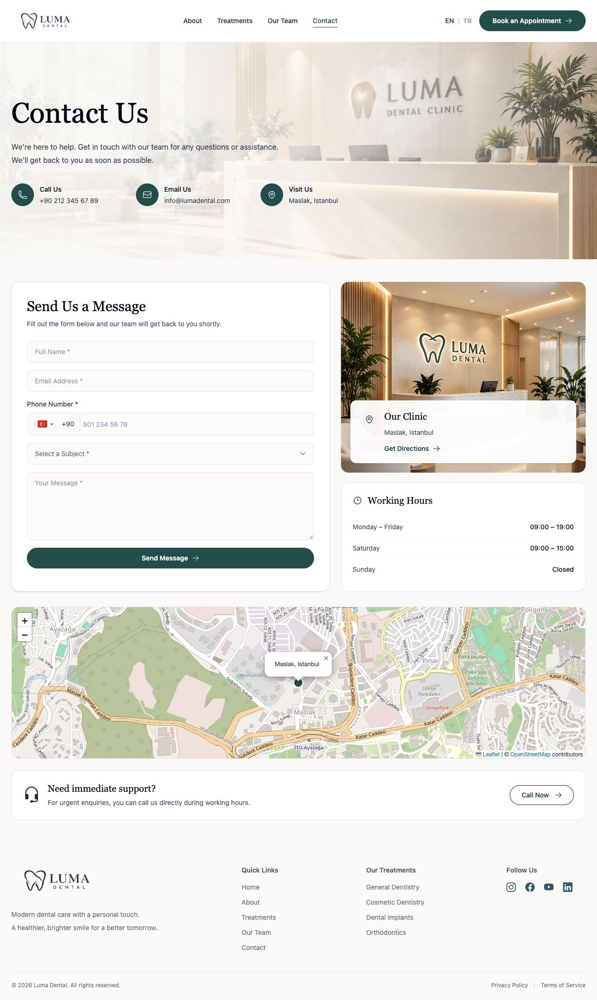

</details>

<details>
<summary>Mobile hamburger navigation</summary>


The menu is collapsed below the desktop breakpoint. It opens from the header button and closes through the button, Escape, an outside click, or navigation. The toggle exposes `aria-expanded` and `aria-controls`; Escape restores focus to the button.

</details>

### Administrative pages

All admin pages require an authenticated user with `is_admin = true`. Turkish equivalents use `/tr/admin`.

| Route | Purpose |
| --- | --- |
| `/admin/login` | Administrator sign-in. |
| `/admin` | Daily overview and failed-delivery retry actions. |
| `/admin/appointments` | Searchable, filterable appointment list. |
| `/admin/appointments/{id}` | Patient details, rescheduling, cancellation, and notification history. |
| `/admin/availability` | Add and list availability windows. |
| `/admin/availability/{id}/edit` | Edit an availability window. |
| `/admin/contacts` | Contact enquiry list with latest delivery status. |
| `/admin/contacts/{id}` | Message content and email history/resend action. |

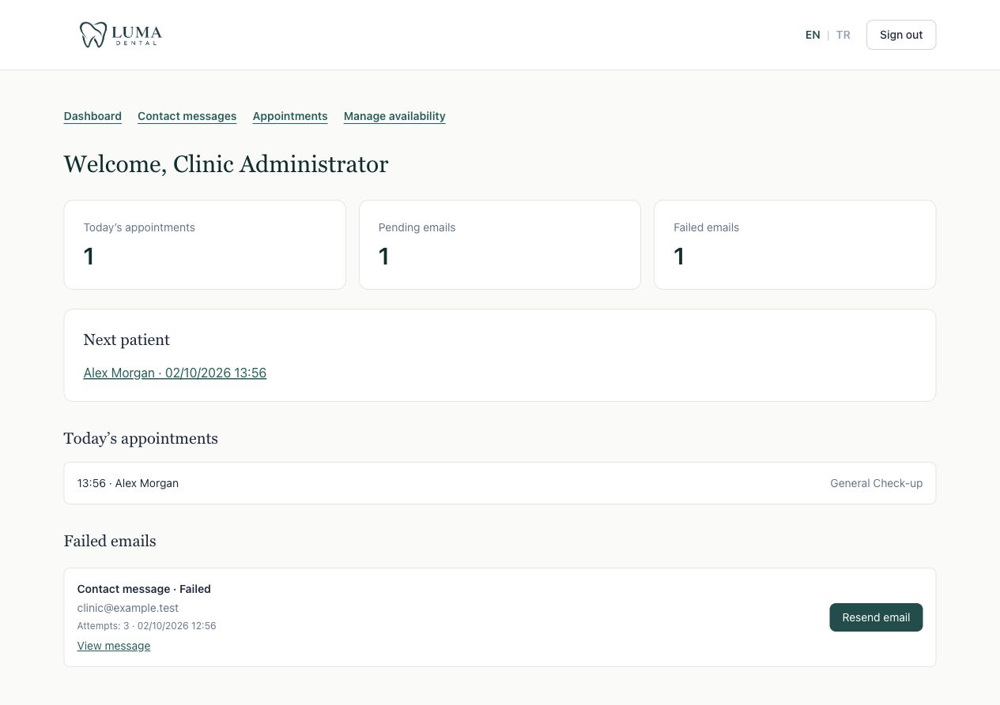

<details>
<summary>Admin sign-in</summary>

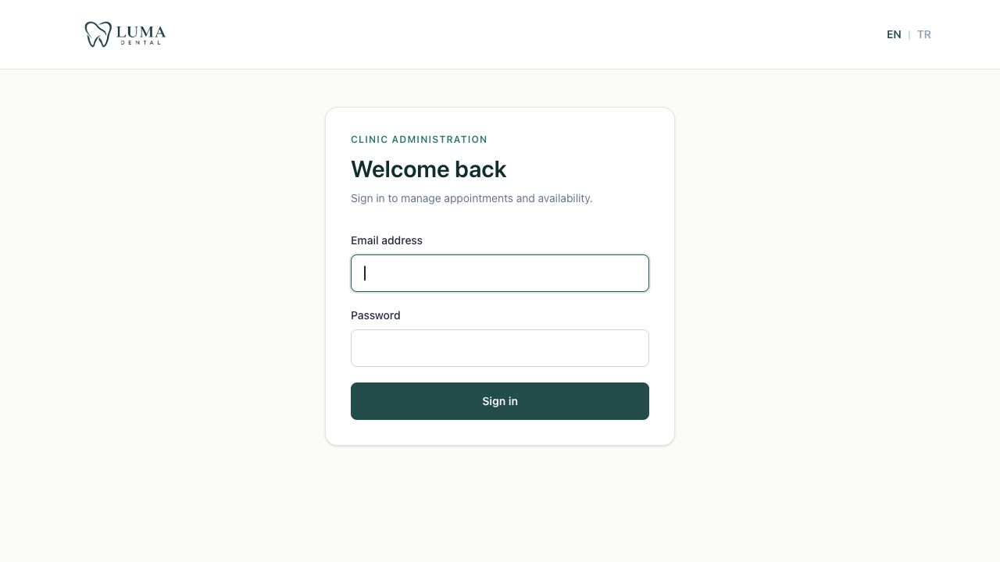

</details>

<details>
<summary>Appointment list and detail</summary>

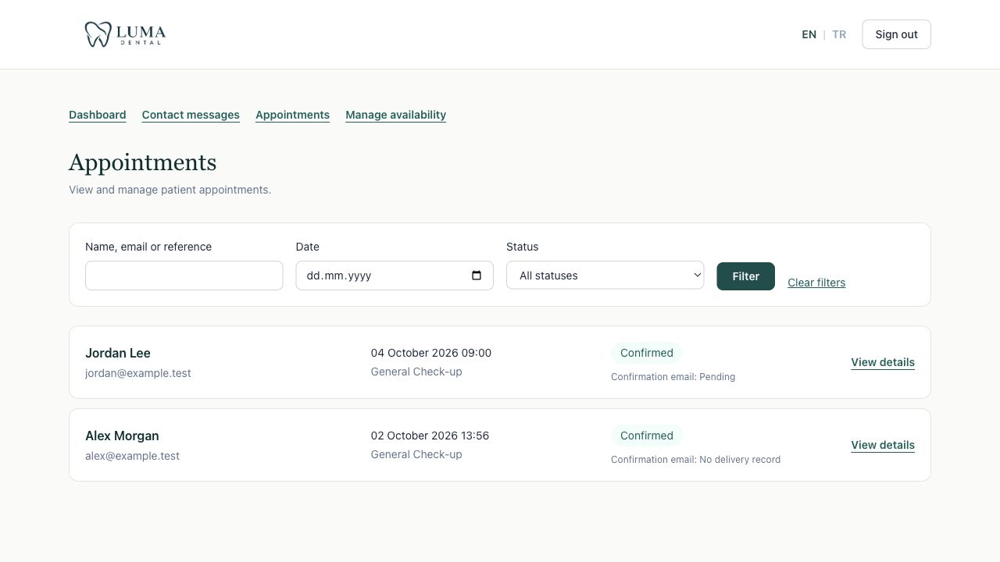

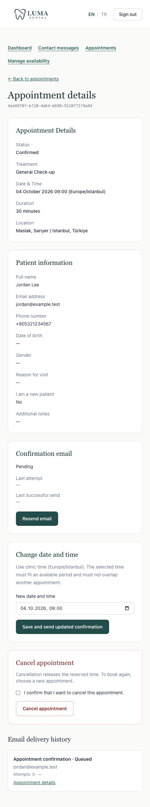

</details>

<details>
<summary>Availability creation and editing</summary>

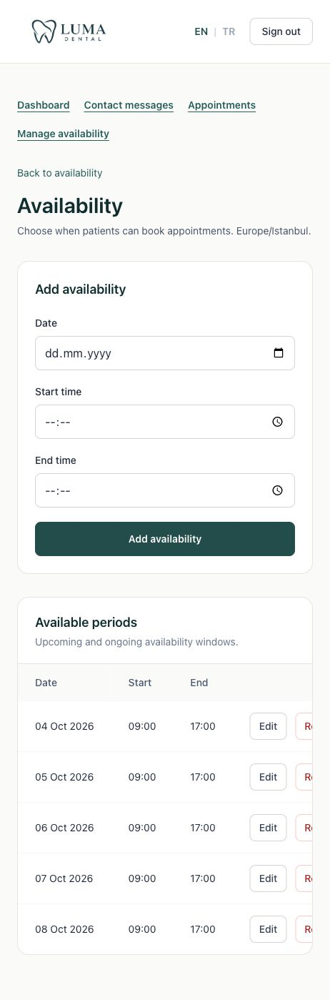

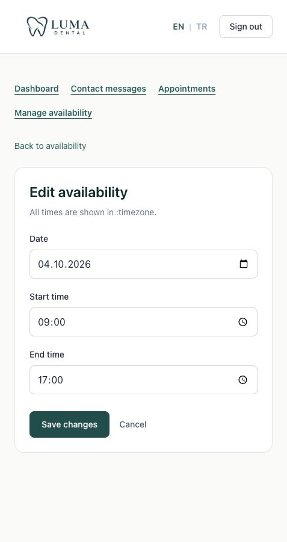

</details>

<details>
<summary>Contact message list and detail</summary>

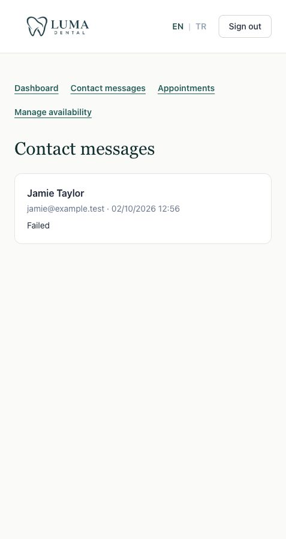

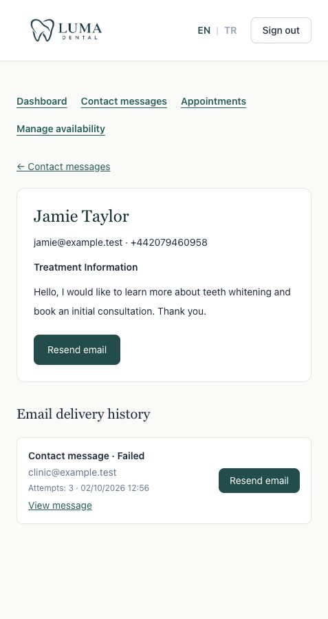

</details>

## Patient booking workflow

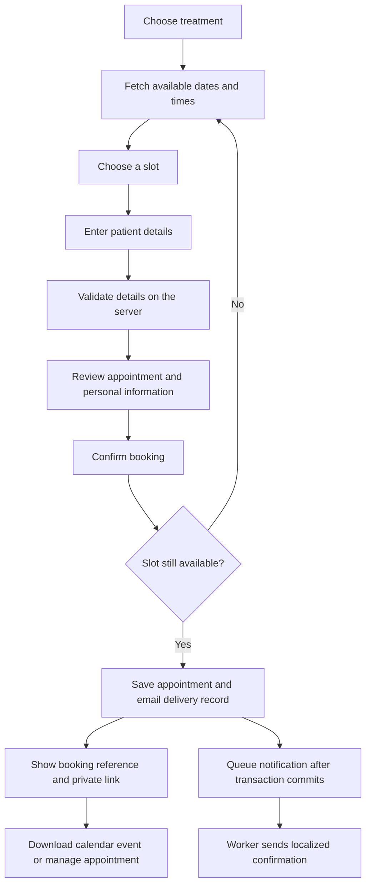

### 1. Choose a treatment

Treatments are database-backed records with a stable code, duration, active flag, display order, and optional image path. Their visible names come from translation files.

The seed data contains eight treatments:

| Treatment | Duration |
| --- | --- |
| General Check-up | 30 minutes |
| Teeth Cleaning | 30 minutes |
| Dental Implants | 60 minutes |
| Teeth Whitening | 60 minutes |
| Orthodontics | 30 minutes |
| Dental Veneers | 60 minutes |
| Root Canal Treatment | 60 minutes |
| Other | 30 minutes |


### 2. Choose a date and time

The browser requests available dates for the displayed month and slots for the selected day. `AppointmentAvailabilityService` builds candidate starts in **30-minute increments** within admin-defined windows. A candidate must fit the full treatment duration, be in the future, and not overlap a confirmed appointment.

Stored timestamps are handled in UTC. Calendar labels, admin inputs, and patient-facing times use the configured clinic timezone, currently `Europe/Istanbul`. A selected slot is not a temporary reservation: availability is checked again when the patient submits the final booking.

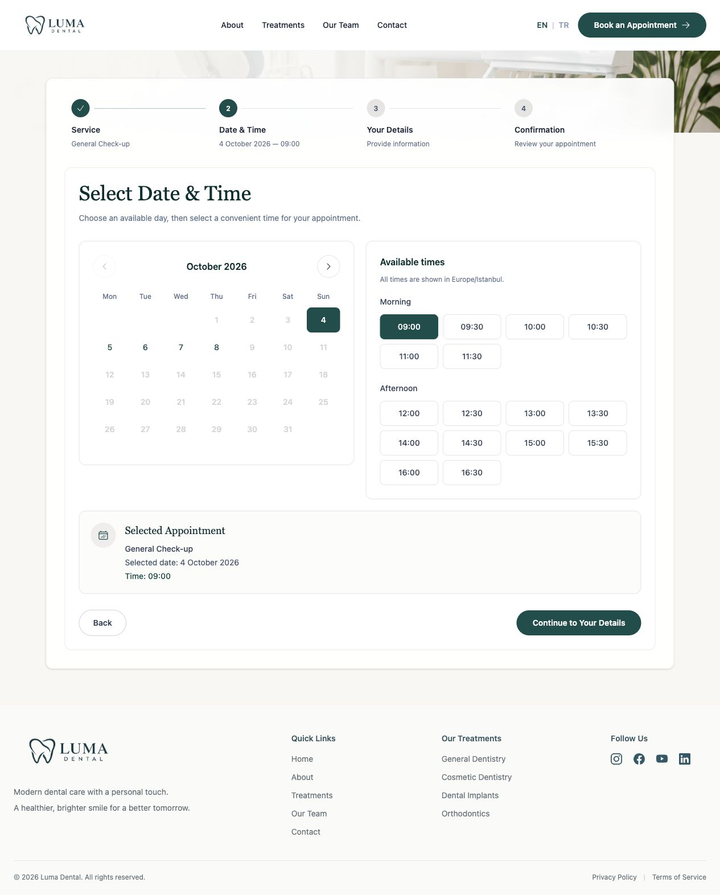

### 3. Provide patient information

Name, email, and phone number are required. Date of birth, gender, reason for visit, and notes are optional. The form also records whether the person is a new patient.

`intl-tel-input` handles the telephone UI. Laravel validates the submitted information, and `laravel-phone` normalizes the phone number into E.164 format. The intermediate details-validation request does not create an appointment.

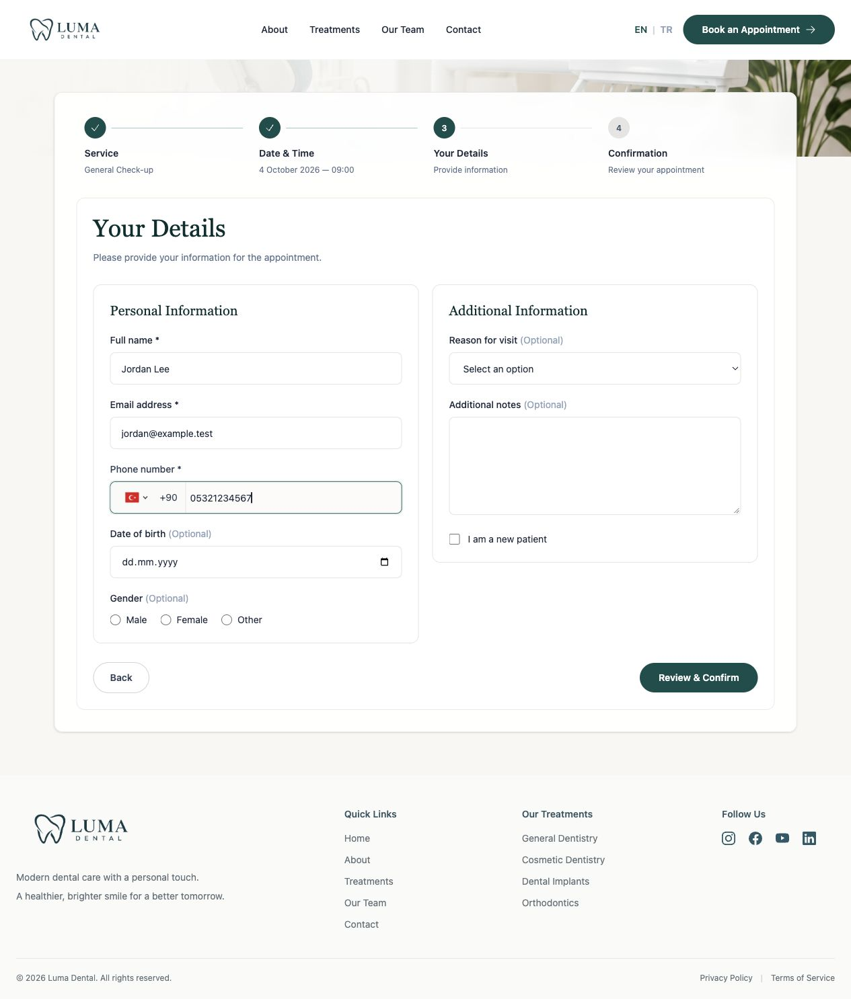

### 4. Review before saving

The review screen displays the treatment, selected time, duration, clinic location, and patient information. Edit actions return to earlier steps. Only **Confirm Appointment** creates the booking.

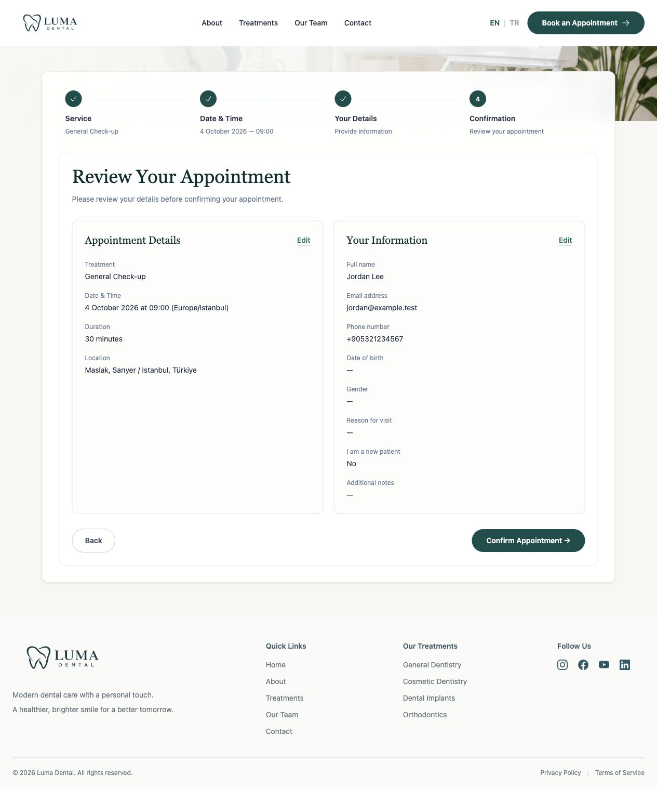

`AppointmentBookingService` uses a transaction and database locking to recheck the treatment and availability. PostgreSQL additionally enforces that confirmed appointment time ranges do not overlap. Half-open intervals allow an appointment to start exactly when another ends.

A session-authorized UUID booking token also becomes the appointment reference. Repeating a submission with the same token returns the existing booking instead of creating a second appointment or initial confirmation delivery.

### 5. Receive the booking result

The success screen displays the booking reference, calendar download, and private management link. It distinguishes a saved appointment from email delivery: a newly queued message is shown as awaiting delivery, not falsely reported as already sent.

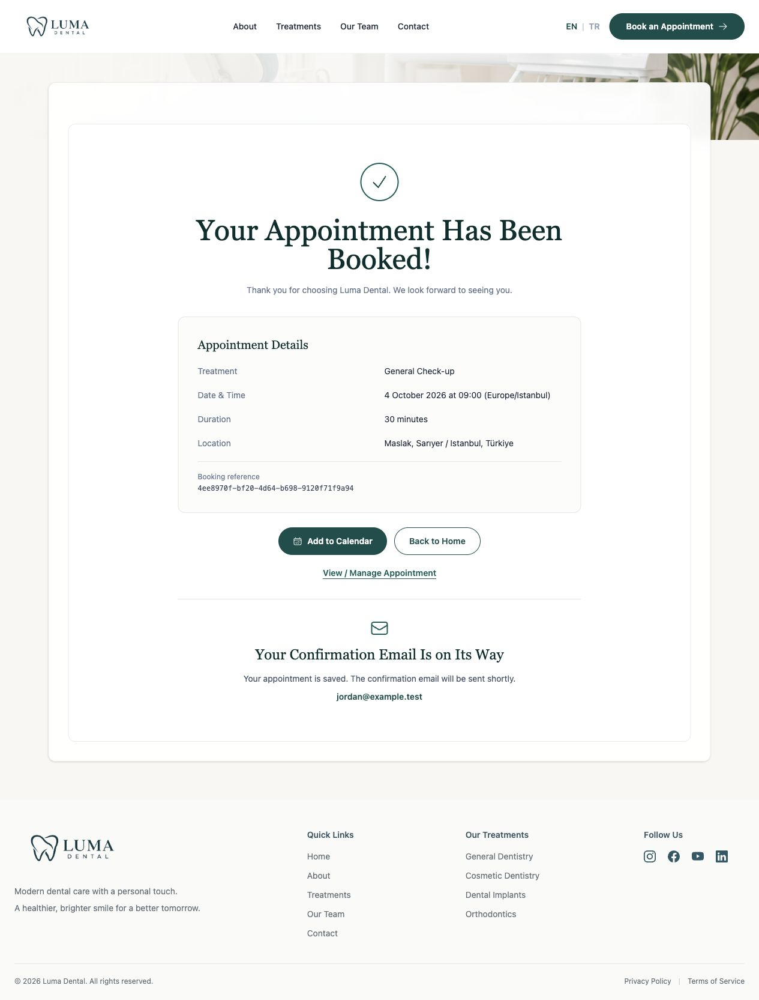

### 6. Manage the appointment through a private link

The management page uses a temporary signed URL. Knowing the reference alone does not grant access. The signature covers the route and parameters; separate signed URLs are created for viewing, cancellation, and calendar download. Links are generated with an expiry 30 days after the later of the appointment start or current time.

Patients can view details, download an `.ics` event, contact the clinic, or cancel a future confirmed appointment after explicitly checking a confirmation box. Cancellation releases the slot and queues a patient cancellation confirmation plus a clinic notification. Repeating the cancellation does not create the same notifications again.

Patient rescheduling is handled by contacting the clinic; the admin performs the date change. Private pages use no-store, no-referrer, and noindex headers.

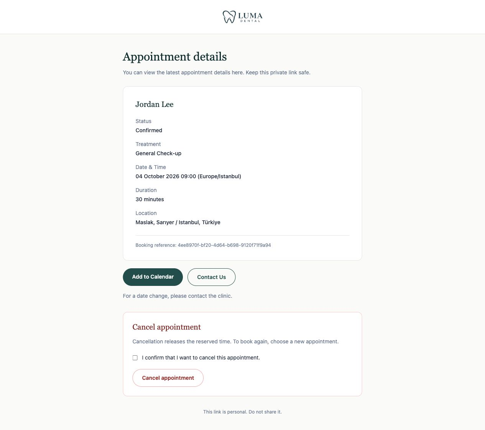

## Clinic administration workflow

1. **Create availability.** An administrator enters a date and start/end times in clinic time. Overlapping availability windows are rejected. Changes that would invalidate existing confirmed bookings are protected.
2. **Review the daily overview.** The dashboard shows today's confirmed appointments, the next upcoming patient, and email counts. Failed delivery entries can be retried.
3. **Find an appointment.** Search by patient name, email, or reference; optionally filter by date or confirmed/cancelled status.
4. **Reschedule a future confirmed appointment.** The new time must fit an availability window and the original booked duration, align to the slot interval, and avoid other bookings. A rescheduling notification includes the previous and new times.
5. **Cancel when necessary.** An explicit confirmation is required. The appointment remains in history as cancelled and its slot becomes available. The patient receives a cancellation notification.
6. **Inspect delivery history.** The detail page shows notification type, recipient, attempts, and delivery state. Failed entries can be retried; resend actions are rate-limited.

If multiple date changes happen before the worker processes the mail queue, outdated confirmation/rescheduling notifications are skipped rather than sent with obsolete appointment times.

## Contact message workflow

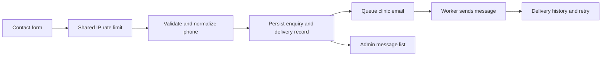

Contact submissions require a name, valid email, valid phone, allowed subject, and message. The subject is one of general enquiry, appointment, treatment information, or other. A shared **three requests per minute per IP** limit applies across English and Turkish endpoints.

The form's success response means the enquiry was stored. Email is a separate background operation, so a transport failure does not erase the message. The clinic recipient is configured through `CONTACT_MAIL_TO`; the contact email uses the sender's name/email as its reply-to address.

Administrators can read stored enquiries even when delivery fails, inspect the delivery history, and request another send. User-provided text is escaped in admin views.

## Email delivery architecture

### Message types

| Delivery kind | Recipient | Content |
| --- | --- | --- |
| `confirmed` | Patient | Initial appointment confirmation, details, reference, and private management link. |
| `rescheduled` | Patient | Updated appointment with both previous and new times. |
| `cancelled` | Patient | Cancellation confirmation. |
| `clinic_cancelled` | Clinic | Notice that the patient cancelled through their private link. |
| `contact` | Clinic | Contact enquiry with sender details and reply-to address. |

Appointment mail uses shared HTML/plain-text templates. Its visual language follows the contact email: Luma branding, a restrained card layout, appointment information, reference, and a clear action link. Both HTML and plain-text content are provided. Locale is saved with the appointment or enquiry and carried into delivery.

### Queue and state lifecycle

`MailDeliveryService` creates a persistent `MailDelivery` record. `SendMailDelivery` is dispatched **after the enclosing database transaction commits**. Actual SMTP work happens in the worker rather than while the patient waits or an appointment row remains locked for booking.

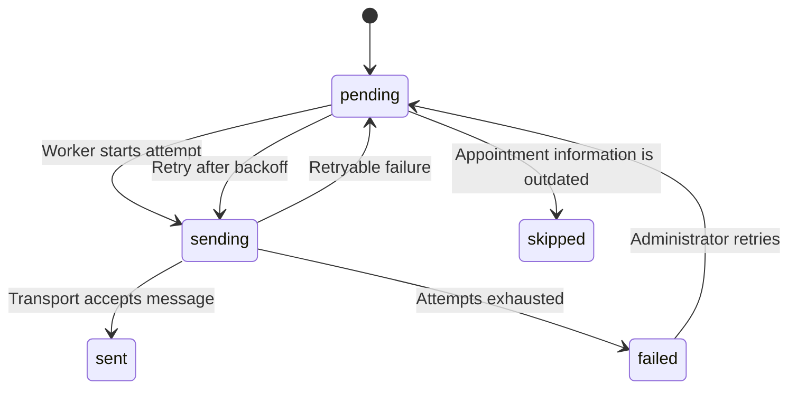

- Maximum attempts per queued job: **3**.
- Retry delays: **60 seconds**, then **300 seconds**.
- Job timeout: **30 seconds**; default database queue reservation timeout: **90 seconds**.
- SMTP timeout defaults to **15 seconds**, configurable with `MAIL_TIMEOUT`.
- Per-delivery overlap middleware helps prevent concurrent processing of the same record.
- Already sent/skipped deliveries are not sent again by the same job.
- Delivery records retain recipient, locale, notification type, payload, attempts, timestamps, and status.
- Appointment-level mail fields provide a convenient summary; `mail_deliveries` contains the detailed history.

`sent` means the configured transport accepted the message. It does not prove inbox placement or that the recipient read it. SMTP delivery is not an exactly-once protocol: a process failure after provider acceptance but before the local success update can still lead to a repeated email.

## Data model and application structure

### Main records

| Model / table | Responsibility |
| --- | --- |
| `User` / `users` | Administrator credentials and `is_admin` authorization flag. |
| `Treatment` / `treatments` | Treatment codes, durations, active state, ordering, and image paths. |
| `AvailabilityWindow` / `availability_windows` | Clinic-bookable time ranges. |
| `Appointment` / `appointments` | UUID reference, treatment, UTC time range, patient details, locale, status, and mail summaries. |
| `ContactMessage` / `contact_messages` | Persisted clinic enquiries. |
| `MailDelivery` / `mail_deliveries` | Notification intent, processing state, retry history, and appointment/contact relation. |
| `jobs`, `failed_jobs`, `job_batches` | Laravel queue infrastructure. |
| `sessions`, `cache`, `cache_locks` | Database-backed session and cache infrastructure when configured. |

Appointments have a treatment relation. A delivery belongs to an appointment or contact message. Database constraints protect valid appointment ranges and statuses, unique references, and non-overlap of confirmed bookings. Cancelled appointments remain stored but no longer participate in the confirmed-booking overlap constraint.

```text
app/
├── Console/Commands/CreateAdmin.php       # Interactive administrator creation
├── Http/Controllers/Admin/               # Dashboard, availability, bookings, enquiries
├── Http/Controllers/                     # Public forms and patient management
├── Http/Requests/                        # Booking and enquiry validation
├── Jobs/SendMailDelivery.php              # Background mail processing
├── Mail/                                 # Confirmation, cancellation, rescheduling, enquiry
├── Models/                               # Eloquent records and relationships
├── Services/                             # Availability, booking, management, mail delivery
└── Support/                              # Admin URLs, signed links, ICS generation
resources/
├── css/                                  # Tailwind entry point
├── js/                                   # Booking, forms, phone input, map, mobile navigation
├── screenshots/                          # README captures with fictional data
└── views/
    ├── admin/                            # Protected clinic workspace
    ├── dental/                           # Public pages and booking partials
    └── emails/                           # HTML and text email templates
lang/en.json, lang/tr.json                 # Interface and email translations
routes/web.php                            # Public and protected web routes
routes/api.php                            # Empty after task API removal
database/migrations/                      # Schema and booking constraints
database/seeders/                         # Treatments and image mapping
tests/Feature/                            # Booking, management, and clinic operations
```

## Local installation

### Prerequisites

- PHP 8.5 is the verified development runtime, with extensions required by Composer and `pdo_pgsql` enabled.
- Composer 2.
- Node.js compatible with the installed Vite release and npm.
- A running PostgreSQL server and a database user allowed to create the application's tables, indexes, and constraints.
- An SMTP service for actual delivery, or Laravel's log mailer for development.

**Do not leave the copied `.env.example` on SQLite.** The example still contains Laravel's SQLite default, while the booking migrations use PostgreSQL-specific SQL.

### 1. Install dependencies

From the project directory:

```bash
composer install
npm ci
cp .env.example .env
php artisan key:generate
```

Copy `.env.example` only for a new installation; do not overwrite an existing configured `.env`.

### 2. Configure PostgreSQL and the application

Create a local database, for example:

```bash
createdb luma_dental
```

Set your own local values in `.env`:

```dotenv
APP_NAME="Luma Dental"
APP_ENV=local
APP_DEBUG=true
APP_URL=http://localhost:8000

DB_CONNECTION=pgsql
DB_HOST=127.0.0.1
DB_PORT=5432
DB_DATABASE=luma_dental
DB_USERNAME=your_local_postgres_user
DB_PASSWORD=your_local_postgres_password

SESSION_DRIVER=database
CACHE_STORE=database
QUEUE_CONNECTION=database

MAIL_MAILER=log
MAIL_FROM_ADDRESS=hello@example.test
MAIL_FROM_NAME="Luma Dental"
CONTACT_MAIL_TO=clinic@example.test
```

These are placeholders, not working credentials. The log mailer writes messages to the configured application log rather than sending them externally.

### 3. Create the schema and seed treatments

```bash
php artisan migrate --no-interaction
php artisan db:seed --class=TreatmentSeeder --no-interaction
php artisan db:seed --class=TreatmentImageSeeder --no-interaction
```

`DatabaseSeeder` calls `TreatmentSeeder`, but the image mapping seeder is separate. Seeders do not create administrator accounts or future availability windows.

### 4. Create an administrator

```bash
php artisan app:create-admin
```

This command is intentionally interactive. It asks for a name, unique email, password, and confirmation. The password must contain at least 12 characters and fit bcrypt's 72-byte limit. It creates a user with `is_admin = true`.

### 5. Start the application

For local development:

```bash
composer run dev
```

This invokes `php artisan dev`, running the application server, frontend tooling, queue listener, and available log tooling together. The application registers a queue listener with three tries and a 30-second timeout.

Alternatively, build assets and run the server/worker in separate terminals:

```bash
npm run build
php artisan serve --host=127.0.0.1 --port=8000
```

```bash
php artisan queue:work database --sleep=1 --tries=3 --timeout=30
```

Open the application at the host configured in `APP_URL`. Use the same host consistently, including for private signed links. Sign in at `/admin/login`, then create future availability under **Manage availability**. Patients will not see bookable dates until availability exists.

## Configuration

| Setting | Location | Meaning |
| --- | --- | --- |
| `APP_URL` | `.env` | Base URL used for generated links, including email links. Set the real HTTPS URL in deployment. |
| `APP_KEY` | `.env` | Application encryption and URL-signing key. Changing it invalidates existing signed links. |
| `DB_*` | `.env` | PostgreSQL connection. |
| `SESSION_DRIVER` / `CACHE_STORE` | `.env` | Session and cache backends; database is supported by the included migrations. |
| `QUEUE_CONNECTION` | `.env` | Use `database` for the documented background mail flow. `sync` runs jobs inline. |
| `MAIL_MAILER` | `.env` | `log` for local inspection, or `smtp` for external delivery. |
| `MAIL_HOST`, `MAIL_PORT`, `MAIL_SCHEME` | `.env` | SMTP endpoint and transport configuration. |
| `MAIL_USERNAME`, `MAIL_PASSWORD` | `.env` | SMTP credentials. |
| `MAIL_FROM_ADDRESS`, `MAIL_FROM_NAME` | `.env` | Email sender identity. |
| `MAIL_TIMEOUT` | `.env`, default 15 | SMTP timeout in seconds. Keep worker and reservation timeouts coordinated. |
| `CONTACT_MAIL_TO` | `.env` via `config/contact.php` | Recipient of contact enquiries and patient-cancellation clinic notices. |
| `appointments.timezone` | `config/appointments.php` | Clinic display/input timezone, currently `Europe/Istanbul`. |
| `lang/en.json`, `lang/tr.json` | Translation files | Public/admin labels, validation text, and email copy. |
| `vite.config.js` | Project root | Asset entry points, Tailwind integration, and fonts. |

After environment changes, clear cached configuration and restart long-running workers:

```bash
php artisan config:clear
php artisan queue:restart
```

SMTP credentials, patient data, and real signed management links must not be copied into documentation or committed to source control.

## Routes and HTTP boundaries

The application is primarily a server-rendered website. The following JSON endpoints support its forms and booking UI; there is no separately versioned public integration API.

| Method | Route | Behavior |
| --- | --- | --- |
| GET | `/appointment/dates` | Available dates for a treatment/month. |
| GET | `/appointment/slots` | Available slots for a treatment/date. |
| POST | `/appointment/details/validate` | Validate patient details without saving a booking. |
| POST | `/appointment` | Final booking with session token, transaction, and conflict checks. |
| POST | `/contact` | Validate/store an enquiry and queue its email. |
| GET | `/appointment/manage/{reference}` | Signed appointment details. |
| POST | `/appointment/manage/{reference}/cancel` | Signed cancellation with explicit confirmation. |
| GET | `/appointment/manage/{reference}/calendar` | Signed ICS download. |
| PATCH | `/admin/appointments/{id}` | Admin rescheduling. |
| POST | `/admin/appointments/{id}/cancel` | Admin cancellation. |
| POST | `/admin/appointments/{id}/resend` | Admin notification resend. |
| POST | `/admin/contacts/{id}/resend` | Admin enquiry-mail resend. |
| POST | `/admin/deliveries/{id}/retry` | Retry a failed delivery. |

Localized form POST routes also exist under `/tr`; admin routes have `/tr/admin` counterparts. State-changing web requests use CSRF protection.

Current rate limits include 60 requests/minute for availability reads, 10/minute for final booking, 30/minute for signed management routes, and 5/minute for admin resend/retry routes. Contact requests share a named 3/minute per-IP limit across languages. Admin login has its own email/IP-based failed-attempt limiter.

## Testing and verification

The project uses PHPUnit. The latest full PostgreSQL verification during feature development completed **43 tests and 241 assertions**. This is a recorded result, not a live CI badge.

### Use an isolated PostgreSQL database

The meaningful booking tests require PostgreSQL because they exercise its exclusion constraints. They skip when using the default SQLite test connection. They also require a database name beginning with `tasks_booking_test_` to protect application data.

```bash
createdb tasks_booking_test_local
php artisan config:clear
vendor/bin/phpunit -c phpunit.pgsql.xml
```

Set the appropriate PostgreSQL credentials in your local test environment. The supplied config selects `tasks_booking_test_local`; it uses array mail, array sessions/cache, and testing environment settings. Queue-focused tests select the database queue explicitly.

**Never point these tests at your application database.** Database-refresh testing recreates tables. The retained `tasks_booking_test_` prefix is a test-safety convention, not a reference to an active task feature.

For a narrower run:

```bash
vendor/bin/phpunit -c phpunit.pgsql.xml tests/Feature/AppointmentBookingTest.php
vendor/bin/phpunit -c phpunit.pgsql.xml tests/Feature/AppointmentManagementTest.php
vendor/bin/phpunit -c phpunit.pgsql.xml tests/Feature/ClinicOperationsTest.php
```

Coverage includes:

- Booking validation, normalized phone data, idempotent retries, and overlapping appointments.
- Admin access restrictions, list filtering, rescheduling, and cancellation.
- Valid, missing, tampered, and expired signed management links.
- Calendar response content and headers.
- Contact rate limiting shared across languages and escaped message rendering.
- Patient/clinic cancellation notifications and localized rescheduling content.
- Queued delivery, retry exhaustion, manual retry, and skipping obsolete notifications.
- Removed task routes returning 404.
- Dashboard counts using the clinic's local day.

Mail tests use fakes, controlled failures, or the array transport, not real recipient inboxes. Browser screenshots in this README were captured separately against fictional preview data.

### Build and formatting

```bash
npm run build
vendor/bin/pint --dirty --format agent
```

`--dirty` requires a Git checkout. In a downloaded directory without `.git`, format explicitly selected PHP files instead:

```bash
vendor/bin/pint --format agent path/to/ChangedFile.php
```

There is no separate JavaScript unit-test framework installed. Frontend behavior is checked through browser interaction and the production asset build.

## Operational notes and troubleshooting

| Symptom | What to check |
| --- | --- |
| Migration fails with range/exclusion SQL errors | Confirm `DB_CONNECTION=pgsql`; SQLite cannot run the booking schema. |
| No dates are selectable | Seed active treatments and add future availability in clinic time. Confirm existing bookings are not occupying all slots. |
| UI changes do not appear / Vite manifest is missing | Run `npm run build`, or keep `npm run dev` running during development. |
| Email remains queued | Start the queue worker with the same environment/database as the web application. |
| Email is marked failed | Check the configured SMTP service and application logs; retry from the admin delivery history after correcting the cause. |
| Email is marked sent but no inbox message arrives | Confirm the mailer is not `log` or `array`, then check provider delivery information and spam folders. |
| Private link returns 403 | Check expiry, signature integrity, `APP_KEY`, and consistent URL scheme/host. A reference by itself is insufficient. |
| Appointment disappears from available times | Another patient may have booked it. Slots are rechecked on final submission. |
| Build mentions `fontaine` | It is an optional font-fallback optimization dependency, not currently installed; the observed build still completes. |

For deployment, point the web server at `public/`, set the correct HTTPS `APP_URL`, disable `APP_DEBUG`, run migrations and the asset build, and supervise the queue worker as a persistent process. Queue processing must continue independently of a developer's terminal. This repository does not include a completed hosting deployment configuration.

## Current limitations

- There is one shared appointment capacity; per-dentist calendars and multi-chair scheduling are not implemented.
- Patients cannot self-reschedule; they contact the clinic for an admin-managed change.
- Appointment states are confirmed/cancelled; completion, no-show, payment, and reminder workflows are not implemented.
- Team names, some contact information, and social/legal footer items are demonstration content that should be replaced before a real clinic launch.
- Some interface polish remains; for example, the availability-edit screenshot exposes an unresolved `:timezone` text placeholder.
- Email success records transport acceptance, not inbox delivery or read receipts.
- The former task routes and application code are removed, but historical task migrations/data have deliberately not been deleted.

The original Laravel Composer metadata declares MIT. Review the applicable package licenses and rights to branding, fonts, and image assets separately before redistribution.
